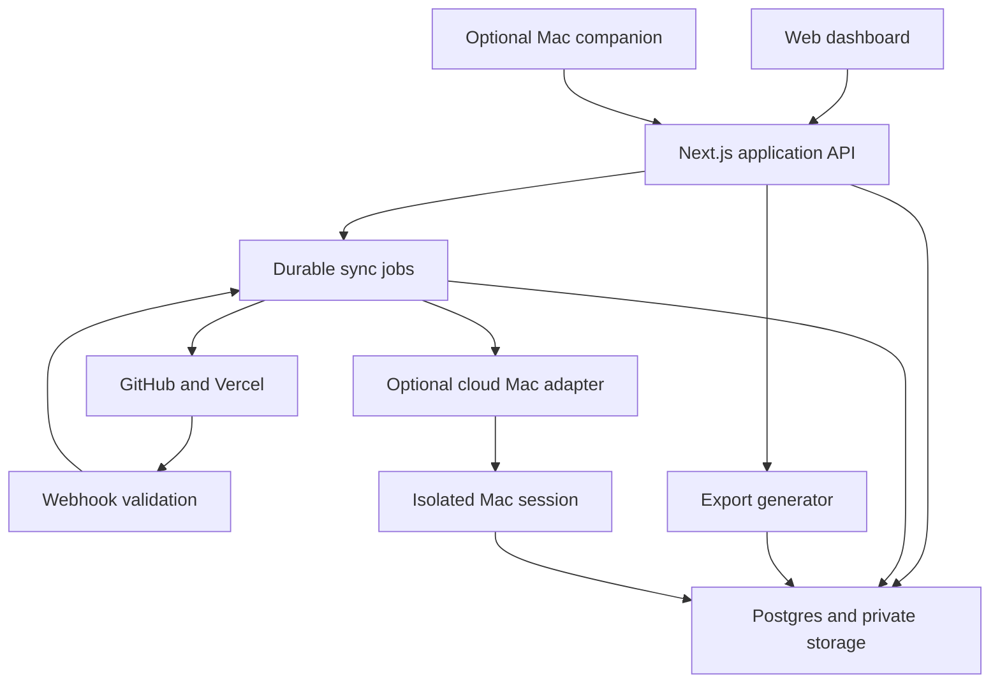

# Recommended architecture

Status: proposed, not implemented. Provider references: [sources](sources.md).

## Stack

| Layer | Recommendation | Reason |
| --- | --- | --- |
| Web application | Next.js App Router, React, TypeScript | Shared language for UI, API handlers, validation, and connector code |
| UI | Tailwind CSS, shadcn/ui, accessible HTML controls | Consistent forms and approachable screens without a custom component framework |
| Tables | TanStack Table; TanStack Query for server-backed data | Control sorting, filtering, pagination, selection, and inline edit states |
| Graph | React Flow with optional ELK layout | Typed nodes/edges and interactive navigation; Postgres stores the relationships |
| Database | Supabase Postgres | Relational constraints, JSONB provider details, full-text search, and tenant policies |
| Identity and files | Supabase Auth and private Storage buckets | One initial service for login, application data, and attachments |
| Data access | Supabase client with user JWTs; SQL migrations and generated database types | Keep the initial persistence layer small and make policies explicit |
| Validation | Zod at API and connector boundaries | Validate external payloads and shared domain contracts |
| Background work | Inngest | Durable steps, retries, scheduled reconciliation, and concurrency controls |
| Hosting | Vercel for the web application and short API/job steps | Fits Next.js and keeps the first deployment simple |
| Desktop, later | Tauri 2, React UI, Rust filesystem/Git boundary, SQLite local index | Selected-folder access, offline metadata, and OS keychain integration |
| Cloud Mac, later | Provider adapter, initially evaluate Namespace Devboxes | Separate compute lifecycle from asset catalog and agent orchestration |
| Verification | Vitest, Playwright, SQL/RLS tests, GitHub Actions | Test normalization, user workflows, and isolation boundaries |

Choose supported stable package versions when scaffolding and commit a lockfile. Add no graph database, vector database, Kubernetes cluster, or separate general-purpose API service to the MVP; the initial queries fit Postgres and one application.

## Runtime boundaries

The runner-to-storage arrow means upload through scoped, expiring artifact grants issued by the application. Runners never receive a database service credential. Vercel functions coordinate bounded operations; builds and agent loops run on the Mac. Long-running terminal connections need a dedicated authenticated relay or a provider-hosted session UI, not a long-lived Vercel function.

## Backend modules

Use modules inside one application: catalog, connections, sync, relations, context, exports, and audit. Keep business rules outside route handlers so the companion and a future API client use the same contracts.

Initial API groups:

| Routes | Responsibility |
| --- | --- |
| `/api/v1/projects`, `/assets`, `/relationships` | Workspace-scoped catalog operations and optimistic concurrency |
| `/api/v1/connections`, `/sync-runs` | Connection setup, scope selection, progress, retry, and disconnect |
| `/api/webhooks/github`, `/vercel` | Provider signature checks and durable event acceptance |
| `/api/v1/notes`, `/attachments` | Context and private upload/download grants |
| `/api/v1/exports` | Consistent catalog snapshot, export status, and expiring download |
| `/api/v1/devices`, `/local-snapshots` | Later device enrollment and scoped metadata upload |
| `/api/v1/mac-sessions`, `/agent-runs` | Later budgeted compute sessions and task results |

List endpoints use allowlisted sort/filter columns and a bounded page size. Server-side filtering and sorting operate on the entire result set, not just the visible page. Mutations accept the current record version and return a conflict if another edit won.

## Reliable synchronization

1. Validate the provider event using its documented signature algorithm and the unmodified request body.
2. Resolve the connected provider account and installation to authorized workspace scopes.
3. Insert a unique event receipt and outbox job transactionally; acknowledge only after durable storage.
4. A dispatcher sends the outbox event to Inngest and can safely retry delivery. An outbox sweeper recovers missed dispatches.
5. The worker fetches current remote state, paginates, normalizes it, and upserts by stable identity. Keep remote state separate from user-maintained fields.
6. Update freshness and relationship evidence, then invalidate the relevant UI query.

Use capped retries with jitter, provider rate-limit headers, and per-connection concurrency. Re-fetch current objects for out-of-order events rather than trusting arrival order. Run scheduled reconciliation to cover webhook gaps. A partial scan cannot establish deletion. Disconnect revokes future reads; retention or removal of imported records is a separate user choice.

## Identity, files, and credentials

Use workspace membership checks and Postgres RLS on every exposed tenant table. User requests retain their user identity through the data layer. Background services use narrowly scoped functions/roles where practical; any administrative client must validate the workspace and connection on every job because privileged credentials can bypass RLS.

Store provider tokens in encrypted secret storage, referenced by opaque IDs. Keep encryption keys outside database backups, use an established secret manager/KMS boundary, and keep secrets out of browser bundles, notes, logs, and exports. The GitHub App private key is server-only.

Uploads use workspace-scoped object paths, content and size validation, short-lived URLs, and safe previews. Render Markdown with raw HTML disabled and sanitize SVG or convert it to a safe preview. URL enrichment must block local/private network addresses and re-check redirects. Treat repository text, threads, and attachments as data rather than executable agent instructions.

Back up both database records and attachment objects; database backups alone are not file backups. Define retention and recovery targets before public beta and perform a restore exercise.

## Proposed source layout

These are future implementation locations; this documentation commit does not create runnable packages.

| Path | Contents |
| --- | --- |
| `apps/web/` | Dashboard, API routes, authenticated job handlers |
| `packages/domain/` | Asset types, relationship rules, validation |
| `packages/connectors/` | GitHub/Vercel adapters and test fixtures |
| `packages/exports/` | Markdown, CSV, JSON, and manifest generation |
| `supabase/migrations/` | Schema, constraints, roles, and RLS |
| `supabase/tests/` | Tenant and role isolation tests |
| `apps/companion/` | Later Tauri application and local index |
| `packages/mac-providers/` | Later provider interface and lifecycle adapter |
| `apps/obsidian-plugin/` | Optional later vault commands |

Use pnpm workspaces. Keep desktop and cloud features independently deployable and feature-gated so they do not delay the catalog.
