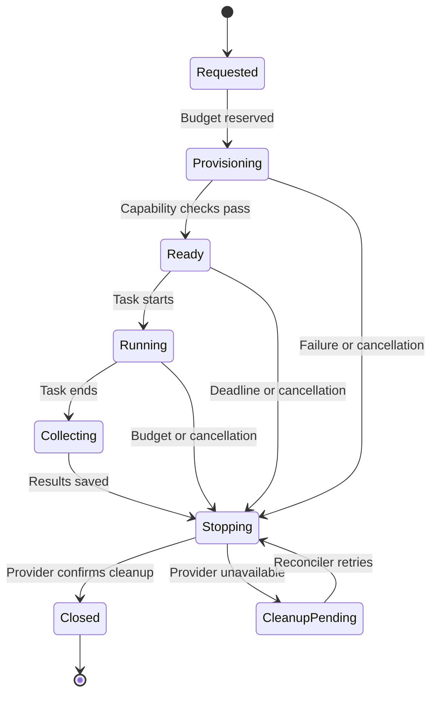

# On-demand cloud Mac design

Status: later implementation phase; no machine has been provisioned. Research date: 2026-11-11.

## Three separate interfaces

| Interface | Responsibility |
| --- | --- |
| Cloud provider API/SDK | Create, inspect, connect to, stop, and delete a macOS environment; expose usage |
| Xcode MCP tools | Give an authorized coding agent project-aware Xcode capabilities inside that environment |
| Build/release tooling | Run builds/tests and, in a separately authorized release workflow, sign or distribute artifacts |

Apple's documented external-agent interface is Xcode's MCP server, reached through `xcrun mcpbridge`. The current instructions require enabling external agents in Xcode's Intelligence settings and opening the project. This is a tool-access mechanism inside a Mac; it does not provision cloud Macs or itself provide network access control. Verify the installed Xcode version and available tools during every image qualification. [Apple documentation](https://developer.apple.com/documentation/xcode/giving-external-agents-access-to-xcode)

Xcode Cloud is a separate CI/CD service with build/workflow APIs through App Store Connect. It is useful for automated verification and distribution, but should not be modeled as a general remote desktop rental. [Xcode Cloud](https://developer.apple.com/documentation/xcode/xcode-cloud)

## Provider recommendation

Evaluate **Namespace Devboxes** first: official documentation describes managed macOS environments, SSH access, configurable Xcode/macOS versions, lifecycle controls, and a TypeScript SDK. Confirm embedding/resale terms before offering centrally billed sessions to customers; a bring-your-own-provider-account pilot is the simpler initial commercial model. [Devboxes](https://namespace.so/docs/devbox) · [SDK](https://namespace.so/docs/reference/sdk)

| Candidate | Evidence and fit | Selection note |
| --- | --- | --- |
| Namespace Devboxes | macOS Devboxes and programmable lifecycle; published minute-based Devbox pricing | First integration spike; verify capacity, account permissions, GUI/Xcode behavior, and cleanup |
| NoMac | Documents macOS sessions over API/MCP/CLI and minute billing | Alternative spike; evaluate security defaults, isolation, support, and API consistency before adopting |
| AWS EC2 Mac | Official FAQ describes dedicated-host billing with a 24-hour minimum allocation | Better for a sustained capacity pool; poor fit for isolated five-minute rentals bought directly |

Namespace's published medium Mac Devbox pricing is 15 Devbox Minutes per elapsed minute at $0.004 each, or **$0.06/minute**. A 20-minute session is therefore approximately **$1.20 compute**, plus any storage, model usage, taxes, or other charges. These are observed provider rates, not a fixed price promise for Developer Helper. Persistent storage is separately billed. [Pricing](https://namespace.so/pricing)

NoMac's primary [API documentation](https://nomac.app/docs/api) describes session creation, idempotency keys, command execution, and cleanup status. Its documented default broad agent permissions require a deliberate security review and explicit access settings. The AWS comparison comes from its [EC2 Mac FAQ](https://aws.amazon.com/ec2/instance-types/mac/faqs/).

The product should say **Start a cloud Mac** and show queued, provisioning, ready, and failed states. Do not guarantee instant availability before measuring provider capacity and boot latency.

## Provider-neutral contract

Define `capabilities`, `quote`, `createSession`, `getSession`, `executeTask`, `collectArtifacts`, `stopSession`, `destroySession`, and `getUsage` as application interfaces. These names are our abstraction, not claims about vendor endpoint names. A quote can be computed from a versioned rate card when no quote API exists.

Capabilities describe GUI availability, Xcode/SDK image choices, architecture, signing support, maximum duration, idle controls, idempotency, and whether stopped storage remains billable. A session request includes workspace, project, selected repository/ref, agent, timeout, maximum spend, retention preference, and a stable request key.

Do not retry an ambiguous create with a new request key. Reconcile the original operation using provider IDs or a durable session label; if the provider cannot safely resolve duplicate creation, disable automatic creation retries.

## Session lifecycle

1. Show the current price estimate and let the user authorize a session budget. Reserve it transactionally so simultaneous requests cannot overspend the same allowance.
2. Create the Mac, record its provider ID immediately, and establish a short-lived connection through the provider's authenticated channel.
3. Check out the selected commit into a dedicated working directory. Create a task branch or keep a patch for review. Scaffold a new project from a pinned, reviewed template if requested.
4. Start the selected coding agent in the guest; enable the Xcode MCP path only after image and permission checks. Run ordinary CI builds through `xcodebuild` or `swift build` where appropriate, including a headless path when GUI tools are unavailable.
5. Stream redacted progress. Capture task results, source commit, toolchain versions, patch, build logs, and selected build artifacts.
6. Stop compute and apply the selected storage-retention policy. For an ephemeral session, destroy its storage after successful artifact collection or a documented recovery window.
7. Confirm provider shutdown/deletion before marking cleanup complete. Reconcile final usage with the estimate and release any unused budget reservation.

## Execution and cost boundaries

Keep the platform's provider credentials outside the guest. Issue repo-scoped, expiring Git credentials and narrowly scoped artifact upload URLs. Use a separate credential/permission path for approved pushes. Treat cloned repositories and build scripts as untrusted code within the isolated session; they must not access other customers, platform secrets, or the catalog database.

MCP transport does not replace authentication or isolation. Run the agent and the Xcode bridge locally in the guest when possible; do not expose an unauthenticated public MCP endpoint. Restrict network access according to the task and avoid copying production secrets into ordinary build sessions.

Signing requires a separate user/team setup and authorization. Use a temporary per-run keychain and scoped signing material; clear it at cleanup. Start the pilot with simulator or unsigned builds and patch downloads. TestFlight distribution, App Store submissions, production deployment, and branch merging are separate actions.

Use both a wall-clock deadline and idle shutdown. A live SSH connection or task can suppress provider idle timers, so inactivity alone is insufficient. An independent cleanup reconciler must survive browser closure, worker crashes, cancellations, and failed artifact uploads. Track `cleanup_pending` and alert on orphaned sessions; do not describe a requested shutdown as completed. [Namespace lifecycle](https://namespace.so/docs/devbox/lifecycle)

Budget limits are enforced through admission, elapsed-time estimates, safety margin, and cancellation. A precise monetary hard cap is only promised if the provider supports it; billing delay and shutdown latency can otherwise produce small overruns. Display compute, storage, and model charges separately.

## Pilot acceptance gate

Test a successful build, failed build, queued capacity, duplicate start, lost create response, user cancellation, worker crash, deadline expiry, unavailable provider, failed artifact upload, and cleanup retry. Verify isolation with two workspaces. Ship only after the system can account for every created session and reliably stop its compute.
