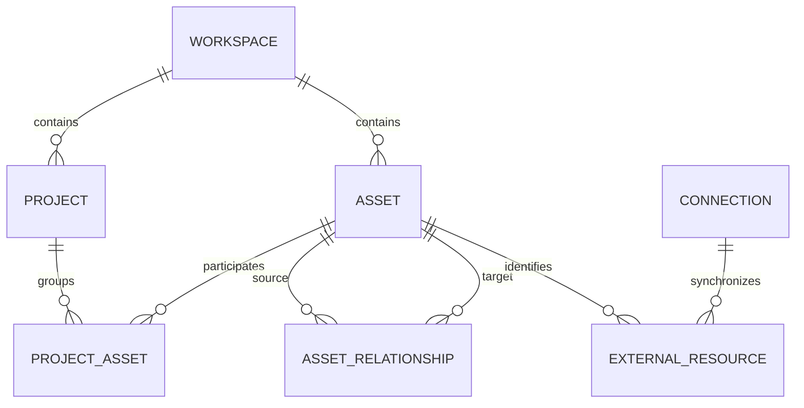

# High-level database schema

This is a logical schema for implementation planning, not an executable migration. Use Postgres UUID primary keys, UTC timestamps, foreign keys, and explicit enum/check constraints. Every tenant-owned row carries `workspace_id`; child references must preserve that scope.

## Core tables

| Table | Important fields | Purpose |
| --- | --- | --- |
| `profiles` | `user_id -> auth.users`, `display_name` | Application profile; authentication remains in Supabase Auth |
| `workspaces` | `id`, `name`, `created_by`, `created_at` | Personal or shared catalog boundary |
| `workspace_members` | `workspace_id`, `user_id`, `role` | Owner, editor, or viewer; unique membership |
| `projects` | `id`, `workspace_id`, `name`, `summary`, `stage`, `next_action`, `version`, `archived_at` | Logical product/idea; stages: idea, prototype, building, live, paused, archived |
| `assets` | `id`, `workspace_id`, `kind`, `provider`, `title_override`, `description`, `canonical_url`, `visibility`, `version`, `archived_at` | Stable identity for a cataloged item |
| `project_assets` | `workspace_id`, `project_id`, `asset_id`, `role` | Many-to-many project membership; one asset may support multiple projects |
| `external_resources` | `workspace_id`, `asset_id`, `connection_id`, `provider`, `provider_host`, `account_id`, `resource_type`, `external_id`, `remote_data jsonb`, `etag`, `remote_updated_at`, `last_seen_at`, `sync_state` | Provider-owned facts, stable import identity, and freshness |
| `asset_relationships` | `id`, `workspace_id`, `from_asset_id`, `to_asset_id`, `relation_type`, `status`, `origin`, `confidence`, `evidence jsonb`, `observed_at`, `version` | Graph edges and their evidence; status: suggested, confirmed, rejected |
| `ownership_records` | `id`, `workspace_id`, `asset_id`, `claim_type`, `subject_label`, `value jsonb`, `evidence_url`, `source`, `observed_at`, `verification_state` | Account ownership, access level, declared responsibility/billing, or license observation |
| `tags`, `asset_tags` | tag name/color; workspace, asset, tag IDs | Searchable user categories |
| `notes` | `id`, `workspace_id`, `project_id?`, `asset_id?`, `body_md`, `source_url?`, `captured_at`, `author_id`, `version` | Context attached to exactly one project or asset |
| `attachments` | `id`, `workspace_id`, `note_id`, `object_key`, `filename`, `media_type`, `byte_size`, `sha256`, `preview_state` | Sketches, diagrams, and imported documents attached through a note |
| `saved_views` | `id`, `workspace_id`, `user_id`, `name`, `view_type`, `filters jsonb`, `columns jsonb`, `sort jsonb`, `layout jsonb` | Personal table settings and graph layouts |

For ownership records, `verification_state` describes the evidence quality, not a legal determination. An observed GitHub account owner, a user-declared maintainer, and a license detected in a source file are different claim types.

## Integration and operational tables

| Table | Important fields | Purpose |
| --- | --- | --- |
| `connections` | `id`, `workspace_id`, `provider`, `provider_host`, `account_id`, `installation_id?`, `scopes`, `secret_ref?`, `status`, `connected_by` | One active logical connection per workspace/provider/account; reconnect preserves identity |
| `sync_runs` | `id`, `workspace_id`, `connection_id`, `state`, `cursor`, `started_at`, `completed_at`, `counts`, `error_code` | Resumable import and reconciliation progress |
| `webhook_receipts` | `id`, `provider`, `app_instance_id`, `delivery_id`, `payload_hash`, `received_at`, `processed_at` | Private operational event inbox; unique delivery identity |
| `job_outbox` | `id`, `workspace_id`, `job_type`, `dedupe_key`, `payload`, `created_at`, `dispatched_at` | Reliable handoff from DB transactions to background work |
| `exports` | `id`, `workspace_id`, `requested_by`, `format`, `selection jsonb`, `snapshot_id`, `schema_version`, `object_key`, `sha256`, `status`, `created_at` | Reproducible export job and downloadable result |
| `audit_events` | `id`, `workspace_id`, `actor_type`, `actor_id`, `action`, `target_id`, `request_id`, `created_at` | Server-written record of changes and sensitive operations |

Keep webhook receipts in an unexposed operational schema. One event may fan out to several explicitly authorized workspaces through separate outbox rows; do not make the raw payload globally readable. Apply short retention and redact unnecessary provider content.

## Later local and cloud tables

| Table | Important fields | Purpose |
| --- | --- | --- |
| `devices` | `id`, `workspace_id`, `user_id`, `name`, `public_key`, `last_seen_at`, `revoked_at` | Paired companion device |
| `local_bindings` | `id`, `workspace_id`, `device_id`, `asset_id`, `root_handle`, `relative_path`, `sync_policy` | Selected file/folder binding; absolute paths remain in local SQLite by default |
| `local_snapshots` | `id`, `workspace_id`, `binding_id`, `branch`, `head_sha`, `dirty_count`, `ahead?`, `behind?`, `upstream_checked_at?`, `observed_at` | Local Git state; absent upstream counts are null, not zero |
| `mac_sessions` | `id`, `workspace_id`, `project_id`, `connection_id`, `provider_session_id`, `request_key`, `state`, `image_version`, `expires_at`, `budget_minor_units`, `currency`, `rate_snapshot`, `cleanup_state` | Durable compute lifecycle and budget reservation |
| `agent_runs` | `id`, `workspace_id`, `session_id`, `agent`, `task`, `source_commit`, `branch_name`, `state`, `started_at`, `ended_at`, `result_asset_id?` | Authorized coding/build activity and provenance |
| `usage_records` | `id`, `workspace_id`, `session_id`, `provider_usage_id`, `quantity`, `unit`, `amount_minor_units`, `currency`, `is_estimate` | Idempotent usage and billed/estimated cost distinction |

Build outputs are document/attachment assets related to their source repository and agent run. Avoid a second, disconnected artifact catalog.

## Core relationships

## Constraints and indexing

1. Give tenant tables a unique `(workspace_id, id)` key and use composite foreign keys in joins, notes, attachments, edges, and job/session associations. RLS supplements these structural checks.
2. For GitHub/Vercel, enforce uniqueness for `(workspace_id, provider, provider_host, resource_type, external_id)` using provider-global resource IDs. Keep the owning account as mutable metadata so a transfer preserves identity. A future provider with account-local IDs must normalize its account scope into the external key. URLs and repository names are not import primary keys; use canonical URLs only for manual-entry duplicate suggestions.
3. Deduplicate edges on `(workspace_id, from_asset_id, to_asset_id, relation_type)`. Reject self-links; retain rejected suggestions so they are not continually proposed again. Cycle checks apply only to relationship types that explicitly require them.
4. Check that a note has exactly one of `project_id` and `asset_id`. Preserve user notes when external access disappears.
5. Deduplicate provider events on `(provider, app_instance_id, delivery_id)` and job dispatch on a stable `dedupe_key`. External actions still require provider-side idempotency or reconciliation.
6. Store null for missing values. Separate remote deletion, access loss, stale data, and sync errors. Hard deletion is an explicit catalog retention action.
7. Index project membership, both edge endpoints, connection/resource keys, tags, and `(workspace_id, updated_at, id)`. Use a GIN index for a maintained text-search vector. JSONB is for provider extensions, not a substitute for core relations.
8. Use optimistic record versions for edits and a consistent transaction snapshot for exports. Do not export half an import transaction.
9. Keep audit rows append-only to ordinary users; do not claim tamper-proof storage. Apply defined retention to operational data.

## Concrete mapping example

An idea note, a Lovable prototype, a GitHub repository, a Vercel hosting project, and its current production deployment are separate assets. The prototype `prototype_of` the repository; the repository `implements` the idea; the deployment `built_from` the repository and `deployment_of` the hosting project. A local checkout `local_checkout_of` the repository.

A monorepo may feed several Vercel projects. A Vercel project may contain many deployment versions. The default map collapses deployment history and highlights the current production target, while preserving individual versions for inspection.
